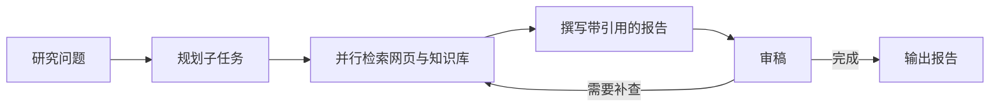

# DeepResearch 多 Agent 研究助手

输入一个研究问题，系统规划子任务，并行检索网页与本地知识库，生成带来源引用的报告，再由审稿节点决定是否补查。项目使用 Python、LangGraph、FastAPI/SSE 和 Vue 3。

**[下载演示视频（MP4 · 37 秒 · 无解说）](https://github.com/Ri4o3c/deepresearch-agent/releases/download/demo-video-v1/deepresearch-demo.mp4)**

以多 Agent 框架选型为例，展示研究进度、子任务、报告引用和任务历史。视频使用合成流程事件和示例报告。

## 研究流程



- **本地 RAG** · 解析与切块保留页码，向量检索和 BM25 经 RRF 融合，可配置重排。当中文问题的召回内容主要为英文时，补充英文查询并保留原查询共同检索。
- **研究工作台** · 用 SSE 展示过程、报告与引用。支持任务快照、历史查看和 checkpoint 续跑。停止接收会结束当前页面的读取，服务端任务可能继续运行。
- **工程实现** · 处理 SSE 跨块 CRLF 和 UTF-8，限制重复发起研究，隔离旧请求回包。支持可选的 Langfuse 观测接入。


## 本地运行

后端依赖见 [requirements.txt](requirements.txt)，ASGI 入口是 `app.server:app`。先配置模型、检索和本地服务，再从仓库根目录启动后端。

```powershell
python -m pip install -r requirements.txt
python -m uvicorn app.server:app --host 127.0.0.1 --port 8000
```

在另一个终端从仓库根目录启动 Vue 3 工作台。开发代理将 `/api` 转发到本机 8000 端口。

```powershell
cd web
npm ci
npm run dev
```

配置与演示可参考 [网页检索说明](docs/search.md)、[Langfuse 说明](docs/langfuse.md)、[Docker 配置模板](docker/) 和 [三分钟演示稿](docs/demo-guide.md)。公开仓库提供源码、模板与评测脚本。凭证、知识库、数据库和外部论文 PDF 由使用者自行准备，发布文件见 [PUBLICATION.md](PUBLICATION.md)。

## 验证记录

| 范围 | 已记录结果 |
| --- | --- |
| 前端与浏览器 | 50 项离线检查通过，构建含类型检查。合成浏览器检查覆盖完成、错误与续跑、历史、离线、引用和键盘操作。 |
| 后端路由 | 25 项受控 FastAPI/ASGI/SSE 路由检查通过，研究图与知识库使用合成替身。 |
| 检索与回答 | Q6、Q4、Q13 只核对检索证据。Q1 单独运行并核对真实模型回答。 |

完整 15 题评估、真实研究整图、真实进程中断恢复、Langfuse trace 和端到端成本与提速尚待验证。详见 [2026-11-07 交付验证记录](docs/validation-20261107.md)。

在 `web/` 运行 `npm test` 和 `npm run build` 可执行前端检查与构建。

## 代码入口与项目分工

| 入口 | 职责 |
| --- | --- |
| [app/graph.py](app/graph.py) | 规划、检索、撰写、审稿与补查 |
| [app/server.py](app/server.py) | 研究 SSE、快照、续跑和知识库接口 |
| [app/search/](app/search/)、[app/rag/](app/rag/) | 网页搜索、本地知识库和检索 |
| [app/llm.py](app/llm.py)、[app/rag/embed.py](app/rag/embed.py) | 模型、Embedding 和重排配置 |
| [web/src/](web/src/) | 工作台、状态管理和报告引用 |

本人负责需求拆解、范围约束、验收标准与运行反馈。通过 Grok Bot 调用 Codex 辅助实现工作流、接口和页面，排查 SSE 分块与请求覆盖问题，并补充回归用例。
