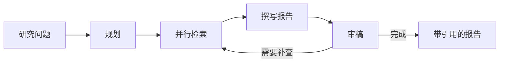
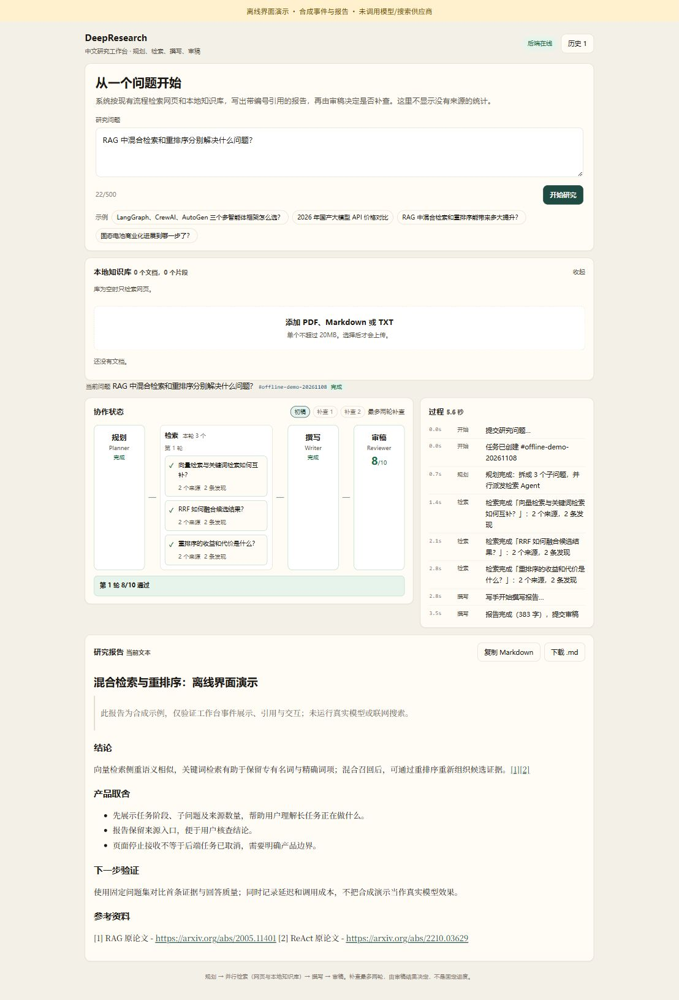

# DeepResearch

用于AI/Agent应用开发求职展示的研究助手。根据问题规划子任务，并行检索网页与本地知识库，生成带引用的报告，再由审稿节点决定是否补查。



## 已实现

- Python、LangGraph与FastAPI：研究SSE、任务快照、checkpoint续跑接口。
- 本地RAG：保留页码的解析切块、向量/BM25召回、RRF融合与可配置重排。
- 跨语言查询：中文问题遇到主要为英文的召回内容时，补充英文查询，保留原查询共同召回；不在查询中补造答案。
- Vue 3中文工作台：过程、报告、引用、任务历史和知识库管理；处理SSE跨块CRLF/UTF-8、单飞和旧请求隔离。
- 可选Langfuse观测接入。停止接收只中止本页读取，不保证服务端研究停止。

## 代码入口

| 位置 | 职责 |
|---|---|
| `app/graph.py` | 规划、研究、撰写、审稿与补查路由 |
| `app/server.py` | 研究/快照/续跑、知识库HTTP接口 |
| `app/search/`、`app/rag/` | 网页搜索、本地知识库与检索 |
| `app/llm.py` | 模型工厂，支持DEEPSEEK_MODEL，默认deepseek-flash非思考 |
| `app/rag/embed.py` | embedding与重排，RERANK_MODEL默认qwen3-rerank |
| `web/src/` | 前端工作台、状态管理与报告引用 |

## 当前验证：2026-11-07

| 样例 | 检查内容 | 结果 |
|---|---|---|
| Q1 | 原RAG论文的检索器、生成器与真实回答 | 第1条证据，回答DPR/BART-large，单例通过 |
| Q6 | 中文技术文档中的reducer与并行合并 | 第1条证据，检索通过 |
| Q4 | 英文ReAct论文的reasoning/action交错 | 第1条证据，检索通过 |
| Q13 | 虚构运维手册的合同审查120秒 | 第1条证据，检索通过 |

三题回归只检查检索证据，没有调用回答模型；Q1单独做过真实回答核对。这些是小样本结果，不能转述为整体准确率或生产效果。

- 前端50项离线检查通过；构建通过，含vue-tsc类型检查。
- 真实FastAPI/ASGI/SSE路由25项受控检查通过，研究图/知识库为合成替身。
- 浏览器合成检查覆盖完成、错误与续跑、历史、离线、引用过滤和键盘；390/300 CSS像素无横向溢出。
- 本轮供应商尝试累计24次，按返回usage与保守价格计算上界0.0339936元，非实际账单。

尚未验证完整15题、真实整图研究、真实进程中断恢复、Langfuse真实trace与端到端成本/提速。不累计旧99项，不以mock结果代替真实模型评测。

## 前端命令

已有依赖环境中，在`web`运行：

```powershell
npm test
npm run build
npm run dev
```

开发代理将`/api`转到本机8000端口，后端入口为`app.server:app`。后端、供应商和本地部署配置需要单独准备。本仓库不包含真实密钥、Docker用户配置、数据库、知识库和评测PDF/fixture，不能据源码快照声称已完成独立部署。

演示顺序见[三分钟演示稿](docs/demo-guide.md)，验证边界见[交付验证记录](docs/validation-20261107.md)。


## AI工具协作与测试验收

通过 Grok Bot 调用 Codex 编排任务：本人负责需求拆解、范围约束、验收标准与运行反馈；Codex 辅助实现研究流程、接口与页面，修正 SSE 跨块解析、旧请求覆盖及请求隔离问题，并协助补充用例、运行前端回归、类型检查和构建。

2026-11-08 已有演示记录中的前端检查通过。软件测试、合成界面演示和真实模型小样本验证分开记录；本次公开源码没有重新执行完整模型评测或进行部署。



截图使用合成事件与报告，仅展示界面链路；实际模型验证范围见上文及 `docs/validation-20261107.md`。

## 获取与配置

后端依赖入口为 `requirements.txt`，前端依赖锁为 `web/package-lock.json`。后端 ASGI 入口 `app.server:app`，在自行安装依赖并配置模型及检索服务后启动。容器辅助配置见 `docker/`，各服务使用 `.env.example` 创建本机配置。

公开源码包含前后端、测试、评测脚本、部署辅助脚本及文档。凭证、数据库、真实知识库、依赖环境、生成目录和外部论文 PDF 未上传；评测所需论文应按配置自行获取。详见 [发布范围与文件清单](PUBLICATION.md)。
